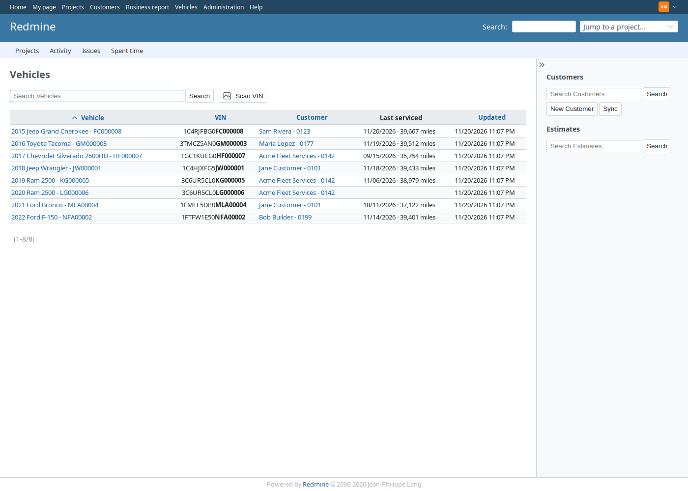
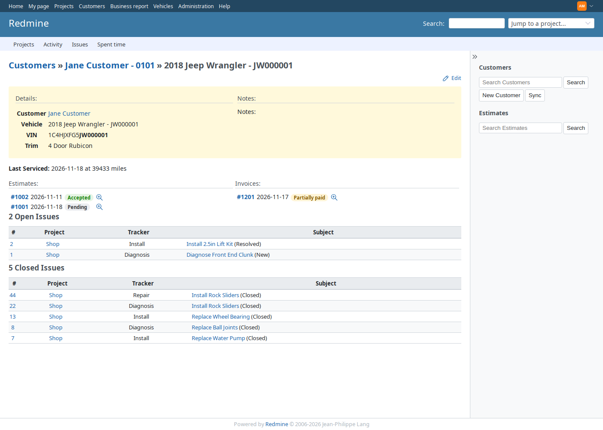
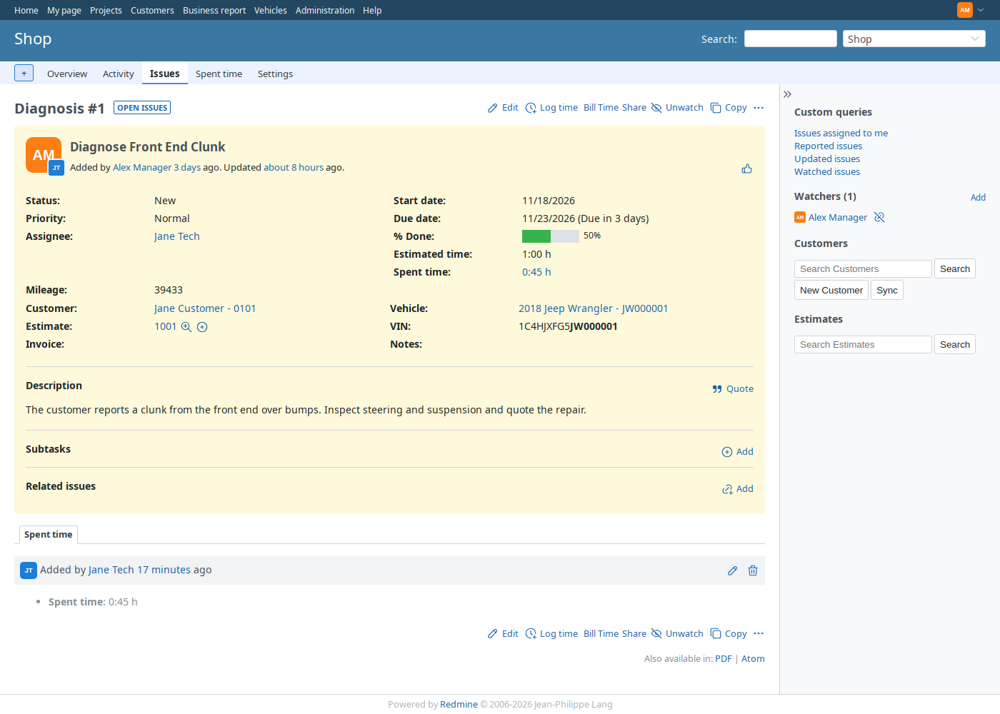
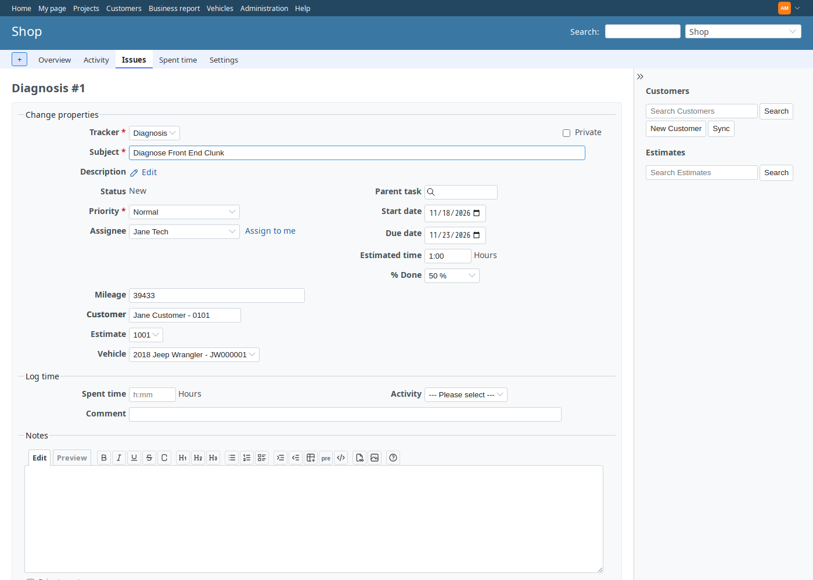
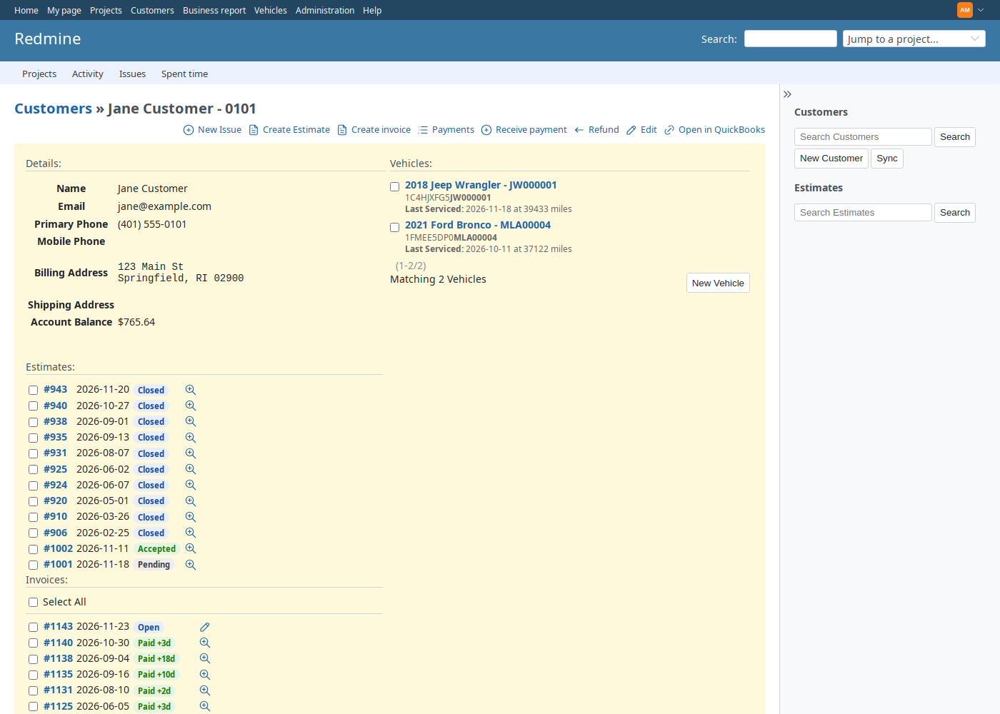
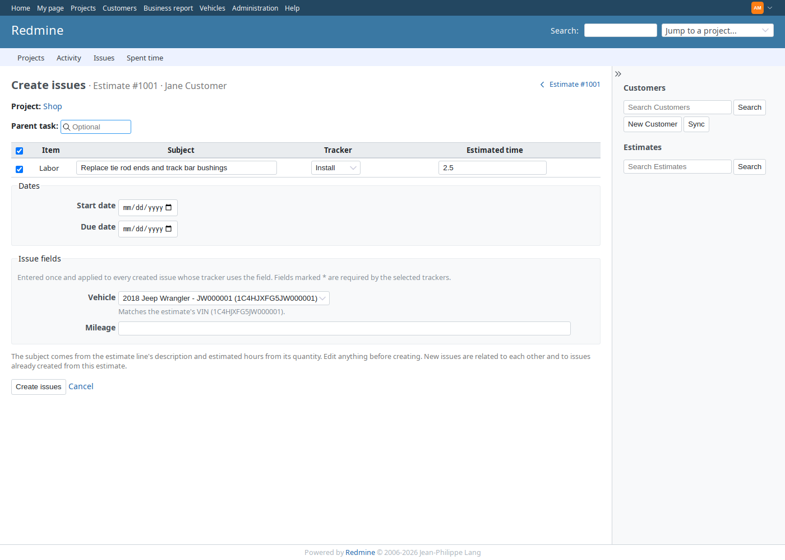
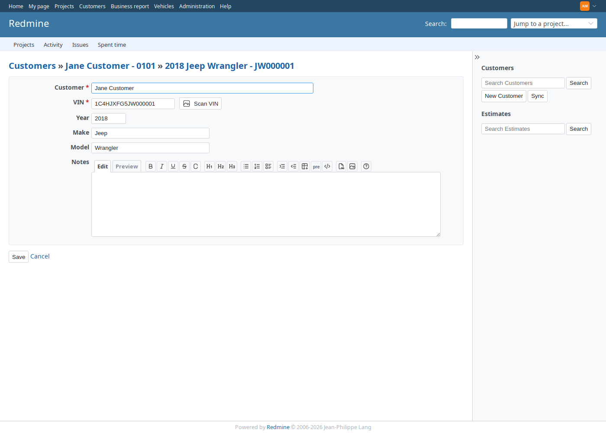
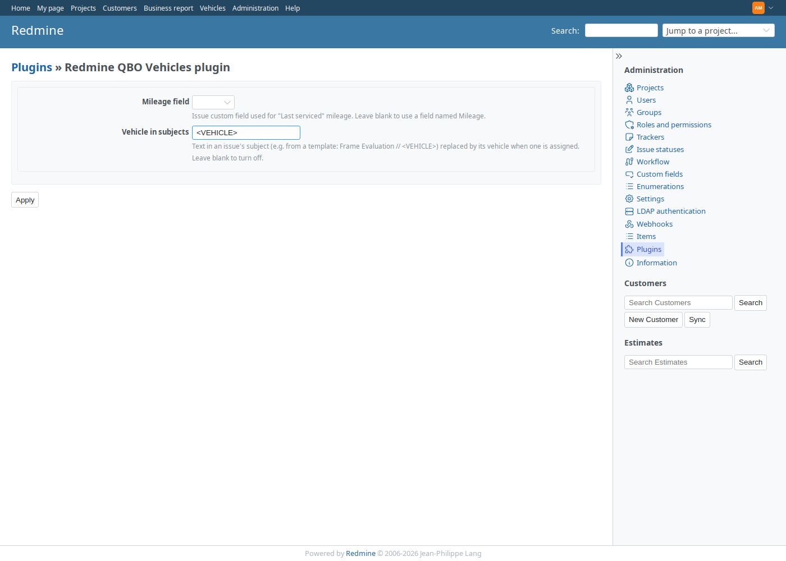

# Redmine QuickBooks Online Vehicles

A Redmine plugin to complement the [Redmine QuickBooks Online](https://github.com/rickbarrette/redmine_qbo) plugin.

The goal of this project is to enable vehicle tracking for customer vehicles within Redmine.

## Requirements

* **Redmine:** 6.1+
* **Parent Plugin:** [Redmine QuickBooks Online](https://github.com/rickbarrette/redmine_qbo)

## Compatibility
| Plugin Version | Redmine Version | Ruby Version |
| :--- | :--- | :--- |
| 2026.1.2+ | Redmine 6.1 | 3.2+ |
| 2026.11.2+ | Redmine 6.1 (redmine_qbo 2026.11.2+) | 3.2+ |

## Features

* **Asset Tracking:** Adds vehicles owned by customers to the system.
* **Issue Association:** Allows these vehicles to be attached directly to Redmine issues for better service tracking.
* **QuickBooks VIN and Mileage fields (redmine_qbo 2026.11.2+):** redmine_qbo shows every QuickBooks text custom field on its estimate/invoice editor; this plugin fills the one named like **VIN** and, if there is one, the one named like **Mileage** or **Odometer**. VINs are shown in capitals.
* **Invoices (redmine_qbo 2026.11.2+):** importing a work order's time or estimate fills the invoice's VIN box with its vehicle's VIN and the mileage box with the highest value of the work orders' **Mileage** issue custom field (Redmine's own custom field named "Mileage"), and an invoice whose work orders are for more than one vehicle isn't saved (one vehicle per invoice).
* **Estimates (redmine_qbo 2026.11.2+):** the VIN box suggests the customer's vehicles, an invoice made from an estimate without a VIN gets its work orders' vehicle, and the Create issues from estimate page has a **Vehicle** for all the issues: preselected with the appointment's vehicle, or else the customer's vehicle whose VIN is on the estimate; when none matches it says so, so the team can pick one before creating the issues.
* **Vehicles page:** every vehicle in a Redmine list (vehicle, VIN, customer, last serviced date and mileage, last update), sortable by column and paged with Redmine's pagination and per-page choices. Search narrows it to the vehicles matching every word (e.g. "2018 jeep wrangler"; a single match opens it). A customer's vehicles (`/customers/:id/vehicles`) are the same list for that customer, with New Vehicle.
* **Scan VIN:** on a phone (or any device with a camera), **Scan VIN** by the VIN field of the vehicle form reads the VIN barcode on the driver's door jamb or the windshield sticker (Code 39, Code 128, Data Matrix or QR) and fills it in, and **Scan VIN** by the Vehicles page search finds the vehicle. A read only counts when it's a VIN (17 characters, no I, O or Q); one whose check digit doesn't match must be read twice the same way. Android's Chrome reads barcodes itself; other browsers (iPhones) use the bundled [ZXing](https://github.com/zxing-js/library) library, loaded only when Scan is tapped, so nothing is sent anywhere. Needs HTTPS (browsers only give websites the camera over HTTPS).
* **Customer page:** ticking a vehicle adds it to the New issue link and to redmine_qbo_calendar's Add appointment link, which opens the new appointment with the vehicle picked.
* **Vehicle in subjects:** an issue subject containing `<VEHICLE>` (e.g. from an issue template: `Frame Evaluation // <VEHICLE>`) gets the vehicle filled in when the issue is saved with one. The placeholder text is a plugin setting; blank turns it off.
* **Appointments (redmine_qbo_calendar):** an appointment added from an estimate gets the customer's vehicle with the estimate's VIN. On an appointment without a vehicle, **Add Vehicle** creates one for the customer, sets it on the appointment and returns to it (for users who may edit appointments).
* **For other plugins:** creating a vehicle calls the `:controller_vehicles_new_after_save` hook (context: `params`, `vehicle`), and the new vehicle form returns to `back_url` when given, so a plugin can link to `new_vehicle_path(customer_id:, back_url:, ...)` and act on the vehicle it gets back.

## Screenshots

All names and figures are made up.

<table>
<tr><td width="50%"><br><sub>The Vehicles page: search, Scan VIN and last serviced mileage</sub></td><td width="50%"><br><sub>A vehicle with its estimates, invoices and issues</sub></td></tr>
<tr><td width="50%"><br><sub>An issue's vehicle and VIN</sub></td><td width="50%"><br><sub>Picking the vehicle on the issue form</sub></td></tr>
<tr><td width="50%"><br><sub>A customer's vehicles on their page</sub></td><td width="50%"><br><sub>Creating issues from an estimate: the vehicle matching its VIN</sub></td></tr>
<tr><td width="50%"><br><sub>The vehicle form with Scan VIN</sub></td><td width="50%"><br><sub>Plugin settings</sub></td></tr>
</table>

## Installation

1.  **Clone the plugin:**
    Navigate to your Redmine plugins directory and clone the repository.
    ```bash
    cd path/to/redmine/plugins
    git clone git@github.com:rickbarrette/redmine_qbo_vehicles.git
    cd redmine_qbo_vehicles
    git checkout <tag> 
    ```
    *(Note: Replace `<tag>` with the specific release version you wish to use, or omit the last line to use the main branch.)*

2.  **Install dependencies:**
    *Crucial for Redmine 6 / Rails 7 compatibility.*
    ```bash
    bundle install
    ```

3.  **Migrate your database:**
    ```bash
    bundle exec rake redmine:plugins:migrate RAILS_ENV=production
    ```

4.  **Restart Redmine:**
    You must restart your Redmine server instance (e.g., Puma, Passenger, Unicorn) for the plugin and hooks to load correctly.

## Usage

1.  **Add a Vehicle:** Navigate to a Customer Profile. You will see a new option to add vehicles to that customer.
2.  **Link to Issue:** Once a vehicle is added to a customer, it can be selected and attached to an Issue relevant to that customer.

## License

> The MIT License (MIT)
>
> Copyright (c) 2016 - 2026 Rick Barrette
>
> Permission is hereby granted, free of charge, to any person obtaining a copy of this software and associated documentation files (the "Software"), to deal in the Software without restriction, including without limitation the rights to use, copy, modify, merge, publish, distribute, sublicense, and/or sell copies of the Software, and to permit persons to whom the Software is furnished to do so, subject to the following conditions:
>
> The above copyright notice and this permission notice shall be included in all copies or substantial portions of the Software.
>
> THE SOFTWARE IS PROVIDED "AS IS", WITHOUT WARRANTY OF ANY KIND, EXPRESS OR IMPLIED, INCLUDING BUT NOT LIMITED TO THE WARRANTIES OF MERCHANTABILITY, FITNESS FOR A PARTICULAR PURPOSE AND NONINFRINGEMENT. IN NO EVENT SHALL THE AUTHORS OR COPYRIGHT HOLDERS BE LIABLE FOR ANY CLAIM, DAMAGES OR OTHER LIABILITY, WHETHER IN AN ACTION OF CONTRACT, TORT OR OTHERWISE, ARISING FROM, OUT OF OR IN CONNECTION WITH THE SOFTWARE OR THE USE OR OTHER DEALINGS IN THE SOFTWARE.
## Third-party code

`assets/javascripts/zxing.min.js` is [@zxing/library](https://github.com/zxing-js/library) 0.23.0 (unmodified UMD build), used by Scan VIN on browsers without built-in barcode reading. It is licensed under the Apache License 2.0: see [LICENSE-zxing.txt](LICENSE-zxing.txt).
